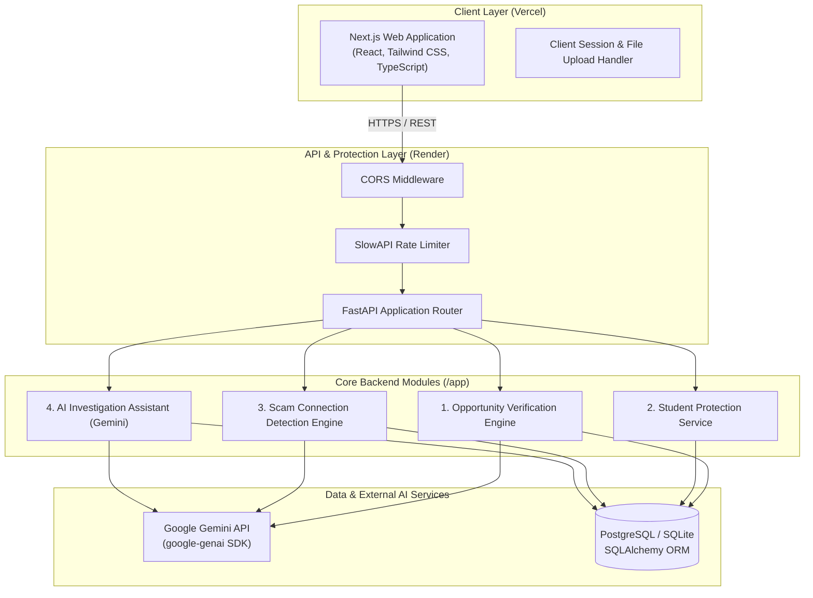

# ScamShield AI — System Architecture & Design

ScamShield AI provides end-to-end detection, analysis, and defense mechanisms against deceptive hiring practices, fraudulent internships, and recruitment scams targeted at students.

---

## 🏛️ High-Level System Architecture

---

## 🧩 4 Core Modules

### 1. Opportunity Verification
- **Purpose**: Authenticates job offers, internship listings, recruiter emails, and company web domains.
- **Key Functions**:
  - **Domain & Domain Age Analysis**: Extracts registered domains using `tldextract` to flag disposable emails (e.g., `@gmail.com` claiming to be corporate HR, `@xyz-careers.top`).
  - **Document & Offer Letter Inspection**: Leverages multi-modal processing (Pillow + Gemini Vision/Text) to inspect PDF and image offer letters for counterfeit corporate stamps, conflicting logos, and suspicious clauses.
  - **Compensation Anomaly Detection**: Benchmarks promised salary against market rates and experience requirements to detect bait-and-switch salary promises.

### 2. Student Protection
- **Purpose**: Directly safeguards students against financial exploitation, coercive deadlines, and credential harvesting.
- **Key Functions**:
  - **Financial Risk Evaluator**: Detects demands for training fees, laptop/equipment security deposits, cryptocurrency payments, or unverified background check portals.
  - **Data Privacy & KYC Audit**: Flags premature requests for sensitive identity documents (Social Security Numbers, Aadhaar/Passport copies, bank login details) before an interview or verified offer.
  - **Safety Action Playbook**: Dynamically delivers step-by-step guidance on how to report fraudulent employers to campus placement cells, federal fraud bureaus, and consumer protection agencies.

### 3. Scam Connection Detection
- **Purpose**: Identifies cross-platform syndicates, coordinated scam rings, and repeated fraud vectors.
- **Key Functions**:
  - **Entity Cross-Referencing**: Links recurrent phone numbers, Telegram/WhatsApp handles, cryptocurrency wallet addresses, and recruiter aliases across multiple reported incidents.
  - **Cluster & Pattern Correlation**: Surfaces patterns across seemingly distinct company names sharing identical corporate addresses or template texts.
  - **Threat Intelligence Registry**: Maintains a structured catalog of verified fraudulent campaigns to power zero-day lookups.

### 4. AI Investigation Assistant
- **Purpose**: An interactive conversational intelligence agent powered by Google Gemini.
- **Key Functions**:
  - **Interactive Recruiter Chat Analysis**: Allows students to paste screenshots or transcript excerpts of recruiter communications for real-time red-flag extraction.
  - **Counter-Inquiry Generator**: Generates professional, probing inquiry scripts that students can send back to recruiters to verify legitimacy without escalating hostility.
  - **Incident Case Dossier**: Synthesizes verified evidence into an exportable incident dossier ready for university placement offices or cybercrime reporting.

---

## 🚀 Deployment Plan

ScamShield AI utilizes a decoupled, modern cloud deployment architecture:

| Component | Provider | Tier / Strategy | Purpose |
| :--- | :--- | :--- | :--- |
| **Frontend** | [Vercel](https://vercel.com) | Edge CDN + Next.js Serverless | Fast, low-latency UI delivery with global edge caching and automatic preview environments. |
| **Backend API** | [Render](https://render.com) | Web Service (Docker container) | Persistent FastAPI application instance with health monitoring, automatic SSL, and zero-downtime deploys. |
| **Database** | Render Managed PostgreSQL / Supabase | PostgreSQL (Production) / SQLite (Dev) | Relational storage for verification histories, reported scam clusters, user sessions, and threat telemetry. |
| **AI Intelligence** | Google AI Studio | Gemini 2.5 / 1.5 Flash & Pro models | Low-latency inference for multimodal text/image fraud scoring and conversational investigation. |

---

## 🔒 Security & Resilience Measures

1. **SlowAPI Rate Limiting**: Per-IP request throttling to prevent automated abuse, denial of service, and API quota exhaustion.
2. **CORS Governance**: Explicit origin filtering configured via `ALLOWED_ORIGINS` to permit only authorized client domains.
3. **Stateless Scalability**: Decoupled backend architecture ready for horizontal scaling behind container orchestration.
4. **Environment Isolation**: Strict segregation between local development configurations (`sqlite:///./scamshield.db`) and production connection strings.
